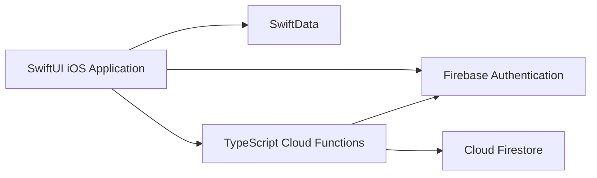

# Best Bike Paths

An iOS application for recording cycling trips, managing personal routes, and discovering bike paths shared by the community.

Best Bike Paths combines a **SwiftUI mobile application** with a **TypeScript backend on Firebase**. The project includes requirements analysis, architectural design, formal modeling with Alloy, implementation, and testing.

Developed for the **Software Engineering II** course at **Politecnico di Milano**, academic year **2025–2026**.

## Overview

Choosing a cycling route involves more than finding a connection between two locations. Cyclists also need information about route conditions and the experiences of other users.

Best Bike Paths brings personal ride recording and community route information into a single application. Users can create paths manually or record their rides, inspect saved routes, manage their visibility, and explore paths shared by other cyclists.

The system maintains a distinction between a user's personal path records and the community routes derived from public contributions.

This repository contains the mobile application, backend services, automated backend tests, and the engineering documents produced throughout the project.

## Application Preview

| Community Routes | Ride Recording | Personal History |
|:---:|:---:|:---:|
|  |  |  |

## Main Features

### Account Management

Users can create an account, verify their email address, sign in, and delete their account.

Firebase Authentication manages user identities. Protected backend operations check the authenticated user before accessing or modifying personal information.

### Path Creation and Ride Recording

The application supports two ways of creating a path:

- **Manual insertion:** users explicitly define and save a route.
- **Automatic recording:** the application collects route information during a recording session using device location and motion capabilities.

Saved paths are associated with the user's account and can be retrieved through the application.

### Personal Path Management

Users can:

- Browse their previously saved paths.
- Display routes and inspect their details.
- Update a path's condition status.
- Change whether a path is public or private.
- Delete a path from their personal collection.

The backend validates path status values and checks ownership when processing protected updates.

### Community Route Discovery

Users can search for community paths using an origin and destination.

Community route information is calculated from linked public user paths. The backend evaluates condition reports within a one-year freshness window and orders returned routes by their calculated status.

Private path contributions are excluded from the public reports used by the community route query.

### Device Permission Management

The application manages access to location and motion capabilities.

Its permission interfaces account for capabilities that are available, unavailable, or previously denied, and guide users through the corresponding device settings where necessary.

## Typical User Workflow

1. Create an account and complete email verification.
2. Grant the device permissions required for recording.
3. Record a cycling trip or insert a path manually.
4. Review the saved path and its condition.
5. Choose whether the path should be public or private.
6. Search for community routes and inspect their details.

## Technology Stack

| Area | Technologies |
|---|---|
| Mobile interface | SwiftUI |
| Local persistence | SwiftData |
| Location services | CoreLocation |
| Motion capabilities | CoreMotion |
| Backend implementation | TypeScript |
| Backend execution | Firebase Cloud Functions |
| User authentication | Firebase Auth |
| Cloud persistence | Cloud Firestore |
| Geospatial processing | Turf.js, GeoFire |
| Automated backend testing | Jest, Firebase Emulator Suite |
| Formal analysis | Alloy |
| Documentation | Typst, UML, architecture diagrams |

## System Architecture

The implemented application connects the iOS client to Firebase Authentication and callable Cloud Functions.



### iOS Client

The client is organized by feature, including:

- Account management and authentication.
- Personal path creation and history.
- Community path discovery.
- Map presentation.
- Location and motion permission management.

Data-source protocols separate application features from their underlying data access implementations.

### Backend

Backend logic is organized into dedicated manager modules:

| Module | Responsibility |
|---|---|
| User Manager | Registration, authentication, verification, and account operations |
| User Path Manager | Personal path storage, retrieval, visibility, status, and deletion |
| Community Path Manager | Community route retrieval and condition aggregation |
| Path Manager | Shared path-processing logic |

`src/index.ts` exposes the callable Cloud Functions and the scheduled cleanup operation.

### Design Documentation

The Design Document describes the proposed system architecture, including service decomposition, an API gateway, and load balancing.

The Implementation and Testing Document explains the Firebase-based application delivered by the team and its component interactions.

## Backend Operations

| Area | Operations |
|---|---|
| Accounts | `createUser`, `signIn`, `deleteUser`, `checkUserExists` |
| Verification | `sendEmailVerificationCode`, `checkEmailVerificationCode` |
| Personal paths | `saveUserPath`, `getUserPaths`, `deleteUserPath` |
| Path updates | `updateUserPathPrivacy`, `updateUserPathStatus` |
| Community paths | `getCommunityPaths` |
| Scheduled maintenance | `cleanupVerificationCodes` |

These operations are implemented as Firebase functions rather than a conventional REST endpoint collection.

## Repository Structure

```text
BestBikePath/
├── Implementation/
│   ├── swift-bbp-client/
│   │   ├── BestBikePath.xcodeproj/
│   │   └── BestBikePath/
│   └── firebase-bbp-backend/
│       ├── functions/
│       │   ├── src/
│       │   │   └── __tests__/
│       │   └── package.json
│       ├── firestore.rules
│       └── firebase.json
├── RASD/                  # Requirements and formal analysis
├── DD/                    # System design
├── ITD/                   # Implementation and testing
├── ATD/                   # Acceptance testing
├── DeliveryFolder/        # Delivered PDF documents
└── integration_test/      # Additional testing material
```

## Development Setup

### Prerequisites

For the iOS application:

- macOS and Xcode.
- A compatible iOS simulator or physical device.
- Firebase configuration for the project being used.
- Apple signing configuration when running on a physical device.

For the backend:

- Node.js **24**, as declared in `functions/package.json`.
- npm.
- Firebase CLI and its emulator prerequisites for emulator-based tests.

### Clone the Repository

```bash
git clone https://github.com/FoadZahediLabaf/BestBikePath.git
cd BestBikePath
```

### Install and Build the Backend

```bash
cd Implementation/firebase-bbp-backend/functions
npm install
npm run build
```

### Firebase Configuration

When configuring a separate development environment:

1. Set the Firebase project association in `.firebaserc`.
2. Configure Firebase Authentication and Cloud Firestore.
3. Use a matching `GoogleService-Info.plist` in the iOS application.
4. Supply the parameters required by the backend authentication and email modules.

| Parameter | Purpose |
|---|---|
| `API_KEY` | Firebase Identity Toolkit requests |
| `EMAIL_SERVICE` | Email service configuration |
| `EMAIL_USER` | Email account username |
| `EMAIL_PASS` | Email account credential |
| `EMAIL_FROM` | Verification message sender |

Credentials should be supplied through the appropriate local or deployment configuration.

### Open the iOS Application

Open the following project in Xcode:

```text
Implementation/swift-bbp-client/BestBikePath.xcodeproj
```

Select the application scheme, configure signing if required, and choose a target device.

A physical device is useful for evaluating the location and motion behavior involved in ride recording.

## Testing

The testing strategy covers backend business logic, access rules, component integration, and documented application scenarios.

### Unit Tests

From the backend `functions` directory:

```bash
npm test -- --testPathIgnorePatterns='integration\.test\.ts|rules\.spec\.ts'
```

This selection excludes test files that require Firebase emulators.

### Firestore Security Rules

```bash
npm run test:rules
```

The rules tests examine permitted and rejected operations for authenticated and unauthenticated users.

### Backend Integration Tests

```bash
npm run test:integration
```

These tests exercise interactions between backend functions and Firebase services in the configured emulator environment.

### Build and Lint

```bash
npm run build
npm run lint
```

### Coverage

```bash
npm run test:coverage
```

The coverage command uses the configured Jest test selection, including emulator-dependent files. Configure the relevant test environment before running the complete suite.

## Formal Analysis

The requirements document includes Alloy models and assertions examining selected system properties.

The analysis covers areas such as:

- Community path recommendations.
- Visibility of public and private paths.
- Recording behavior.
- Device capability permissions.

The document presents the models, the assertions checked within their specified scopes, and example instances produced by the analysis.

## Engineering Documents

| Document | Contents |
|---|---|
| [Requirements Analysis and Specification](DeliveryFolder/RASDv2.pdf) | Requirements, use cases, domain assumptions, and Alloy analysis |
| [Design Document](DeliveryFolder/DDv1.pdf) | Architecture, interfaces, data models, and design decisions |
| [Implementation and Testing](DeliveryFolder/ITDv1.pdf) | Implemented functionality, testing, and installation guidance |
| [Acceptance Testing](DeliveryFolder/ATDv1.pdf) | Acceptance scenarios and assessment |

Editable document sources are available in the corresponding `RASD`, `DD`, `ITD`, and `ATD` directories.

## Authors

- Lorenzo Fiamingo
- Alexander Gabriel Fox
- Foad Zahedi Labaf

## Copyright

© 2025–2026 the respective project contributors. All rights reserved.

Third-party materials remain subject to their original licenses and terms.
