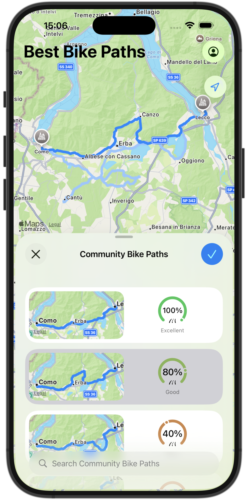
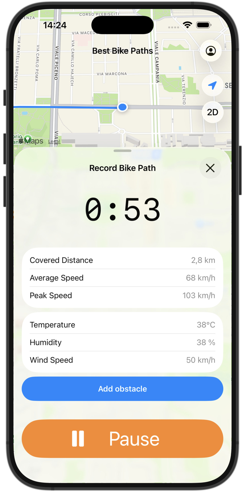
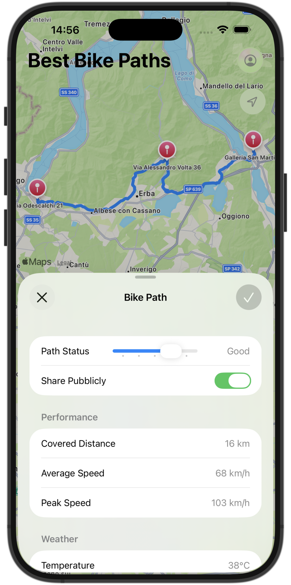

# Best Bike Paths

An iOS cycling application for recording rides, sharing bike paths, and discovering community routes, with a SwiftUI client and a TypeScript backend on Firebase.

**SwiftUI · TypeScript · Firebase Auth · Cloud Firestore · Cloud Functions · Jest · Alloy**

Developed by **Lorenzo Fiamingo, Alexander Gabriel Fox, and Foad Zahedi Labaf** for Software Engineering II at Politecnico di Milano.

## See the application

<table>
  <tr>
    <td align="center"><br>Discover community paths</td>
    <td align="center"><br>Record a ride</td>
    <td align="center"><br>Review ride history</td>
  </tr>
</table>

## What it does

- Records bike rides using device location and motion capabilities.
- Supports account creation, authentication, and personal path management.
- Lets users manage path visibility and browse community routes.
- Stores route data in Cloud Firestore and processes it through callable Cloud Functions.

## My contribution — Foad Zahedi Labaf

Contributed to the system architecture and engineering documentation, formal analysis with Alloy, and development of the SwiftUI application and TypeScript backend. This is a team project; the repository includes the team's shared implementation and documentation.

## Architecture and implementation

The implemented prototype uses a **SwiftUI iOS client → Firebase callable Cloud Functions → Cloud Firestore**, with Firebase Auth for identity. Backend modules cover users, personal paths, and community paths.

The [Design Document](DD/main.typ) also explores a broader service architecture with an API gateway and load balancing. Those design choices should be distinguished from the Firebase prototype delivered in this repository.

- [iOS application](Implementation/swift-bbp-client/BestBikePath)
- [Backend entry points](Implementation/firebase-bbp-backend/functions/src/index.ts)
- [Backend tests](Implementation/firebase-bbp-backend/functions/src/__tests__)
- [Firestore access rules](Implementation/firebase-bbp-backend/firestore.rules)

## Explore the engineering work

| Document | Contents |
|---|---|
| [Requirements and formal analysis](RASD/main.typ) | Use cases, requirements, and Alloy models/assertions |
| [System design](DD/main.typ) | Architecture, interfaces, data models, and design decisions |
| [Implementation and testing](ITD/main.typ) | Implemented features, test scenarios, and installation guidance |
| [Acceptance testing](ATD/main.typ) | Acceptance scenarios and assessment |

The Alloy models are embedded in the requirements document. Tests include manager unit tests, Firestore security-rule tests, and backend integration tests.

## Backend: build and unit tests

Prerequisite: **Node.js 24**, as declared in the backend package configuration.

```bash
git clone https://github.com/FoadZahediLabaf/BestBikePath.git
cd BestBikePath/Implementation/firebase-bbp-backend/functions
npm install
npm run build
npm test -- --testPathIgnorePatterns='integration\.test\.ts|rules\.spec\.ts'
```

The command above excludes tests that need Firebase emulators. With the Firebase CLI installed and its emulator prerequisites configured, run the dedicated suites from the same directory:

```bash
npm run test:rules
npm run test:integration
```

For the iOS client, open [BestBikePath.xcodeproj](Implementation/swift-bbp-client/BestBikePath.xcodeproj) in Xcode. Firebase configuration and access to the relevant project are needed to use the connected application; see the implementation document for setup details.

## Project scope

An academic team project and prototype, covering requirements, design, formal modeling, implementation, and testing. The documents explain the implemented scope and the wider proposed design.
